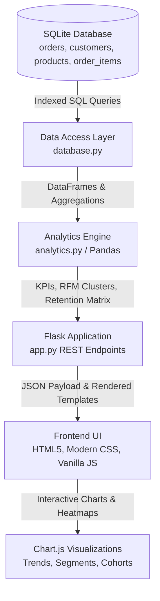

# 📊 E-Commerce Sales & Customer Analytics Dashboard

[](https://www.python.org/)
[](https://flask.palletsprojects.com/)
[](https://pandas.pydata.org/)
[](https://www.sqlite.org/)
[](https://www.chartjs.org/)
[](LICENSE)

An end-to-end, full-stack data analytics and business intelligence platform built with **Python, Flask, Pandas, SQL (SQLite), and Chart.js**. Designed to bridge raw transactional data with actionable executive insights, customer segmentation, unit economics, and retention cohorts.

---

## 🎯 Resume Highlights & Key Metrics

* **Analyzed 5,369 orders from 1,280 customers**, tracking **$1.06M in revenue**, **$618K in net profit**, a **$216.02 Average Order Value (AOV)**, and a **58.6% gross margin**.
* **Segmented customers into 7 strategic clusters via RFM quintile modeling** and measured returning-customer behavior, uncovering that **returning customers generate 74.8% of total revenue** ($789K+).
* **Engineered a 12-month customer acquisition cohort retention matrix** and Pareto (80/20) contribution model revealing that the top 20% of customers drive 53.6% of gross revenue.
* **Delivered interactive, responsive dashboards** featuring real-time date filtering, dynamic Chart.js visualizations, searchable order ledgers with line-item drilldowns, and one-click CSV report exports.

---

## 🏗️ Architecture & Technical Flow



### Tech Stack
| Component | Technology | Rationale |
| :--- | :--- | :--- |
| **Backend Framework** | Python 3 / Flask | Lightweight, performant microframework with zero bloat |
| **Data Processing** | Pandas & NumPy | High-performance aggregations, quantile scoring, cohort pivoting |
| **Relational Database** | SQLite3 | ACID-compliant, zero-configuration local SQL engine with indexes |
| **Frontend Visualizations** | Chart.js 4.4 | Responsive, interactive HTML5 canvas charts (line, bar, donut) |
| **Styling & UI** | Custom Responsive CSS | Clean, user-friendly modern dashboard design without clunky CSS frameworks |

---

## 🌟 Key Features

### 1. 📈 Executive Sales & Profitability Dashboard
- **Real-Time KPIs**: Gross Revenue, Net Profit, Gross Margin %, Average Order Value (AOV), and Order Volumes.
- **Returning Customer Tracking**: Real-time measurement of repeat customer share of revenue and buyer counts.
- **Dual-Metric Sales Trend**: Dual-line visualization showing monthly revenue vs. net profit trajectory.
- **Departmental Breakdown**: Donut chart displaying revenue and margin distribution across 5 core categories.
- **Top 8 Products**: Ranking bestsellers by revenue generation and profitability.

### 2. 👥 Customer Analytics & RFM Segmentation
- **RFM Quintile Clustering**: Categorizes 1,200+ customers into 7 actionable tiers:
  - *Champions*, *Loyal Customers*, *Potential Loyalists*, *Promising / New*, *Needs Attention*, *At Risk*, and *Hibernating / Lost*.
- **Strategic Action Matrix**: Tabulates customer share, revenue share, average monetary value, purchase frequency, and recency days.
- **Pareto (80/20) Analysis**: Tracks cumulative customer percent vs. cumulative revenue percent.
- **Monthly Cohort Retention Heatmap**: Month-by-month retention matrix (M+0 to M+11) with color-coded gradients.

### 3. 📦 Products & Unit Economics
- Searchable product catalog with units sold, gross revenue, net profit, margin %, and inventory status.
- Category filtering and sorting by revenue, profit, or margin percentage.

### 4. 🔍 Orders Ledger & Customer Explorer
- Searchable by customer name, email address, or Order ID.
- Status filters (`Completed`, `Processing`, `Cancelled`, `Refunded`).
- **Interactive Modals**:
  - Click any order row to inspect unit economics and individual line items.
  - Click any customer name to open their lifetime spending profile, AOV, and purchase history.
- **CSV Data Export**: Download raw reports for external analysis in Excel or BI tools.

---

## 📂 Project Structure

```
ecommerce-analytics-dashboard/
├── app.py                      # Flask web application and REST API endpoints
├── analytics.py                # Pandas & SQL analytical services (RFM, Cohorts, KPIs)
├── database.py                 # SQLite schema setup, connection context, and indexing
├── generate_data.py            # Reproducible synthetic dataset generator (5,400+ orders)
├── requirements.txt            # Python dependencies (Flask, pandas)
├── README.md                   # Comprehensive project documentation
├── static/
│   ├── css/
│   │   └── style.css           # Clean, responsive CSS stylesheet
│   └── js/
│       └── dashboard.js        # Chart.js initialization, live filtering, and modals
└── templates/
    ├── base.html               # Master layout with sidebar and topbar
    ├── overview.html           # Executive Sales & Revenue Dashboard
    ├── customers.html          # RFM Segmentation & Cohort Retention Analytics
    ├── products.html           # Product catalog performance & margins
    └── orders.html             # Searchable order ledger & customer drill-down
```

---

## 🚀 How to Run the Project Locally

Follow these quick steps to get the dashboard up and running on your local machine:

### Prerequisites
- Python 3.10 or newer installed. Check with:
  ```bash
  python --version
  ```

### Step 1: Clone or Navigate to the Repository
```bash
cd ecommerce-analytics-dashboard
```

### Step 2: (Optional but Recommended) Create a Virtual Environment
- **On Windows (PowerShell / Command Prompt)**:
  ```bash
  python -m venv venv
  venv\Scripts\activate
  ```
- **On macOS / Linux**:
  ```bash
  python3 -m venv venv
  source venv/bin/activate
  ```

### Step 3: Install Required Dependencies
```bash
pip install -r requirements.txt
```

### Step 4: Run the Application
```bash
python app.py
```
> **Note**: On the first run, the application will automatically initialize the SQLite database and seed the complete dataset (1,280 customers, 50 products, 5,300+ orders).

### Step 5: Open in Your Browser
Open your browser and navigate to:
```
http://127.0.0.1:5000
```

---

## 💡 Analytical Query & Calculation Highlights

### RFM Customer Scoring Engine (Pandas)
```python
# Scoring Recency, Frequency, and Monetary quintiles
df["r_score"] = pd.qcut(df["recency"].rank(method="first"), 5, labels=[5, 4, 3, 2, 1]).astype(int)
df["f_score"] = pd.qcut(df["frequency"].rank(method="first"), 5, labels=[1, 2, 3, 4, 5]).astype(int)
df["m_score"] = pd.qcut(df["monetary"].rank(method="first"), 5, labels=[1, 2, 3, 4, 5]).astype(int)
```

### Returning Customer Revenue Share (SQL + Pandas)
```sql
SELECT id, customer_id, order_date, total_amount, total_profit
FROM orders
WHERE status = 'Completed'
ORDER BY customer_id, order_date ASC;
```
```python
df["order_seq"] = df.groupby("customer_id").cumcount() + 1
returning_revenue = df[df["order_seq"] > 1]["total_amount"].sum()
returning_rev_pct = (returning_revenue / df["total_amount"].sum()) * 100
# Result: 74.84% of revenue generated by returning customer transactions
```

---

## 📄 License
This project is open-source and available under the [MIT License](LICENSE).
